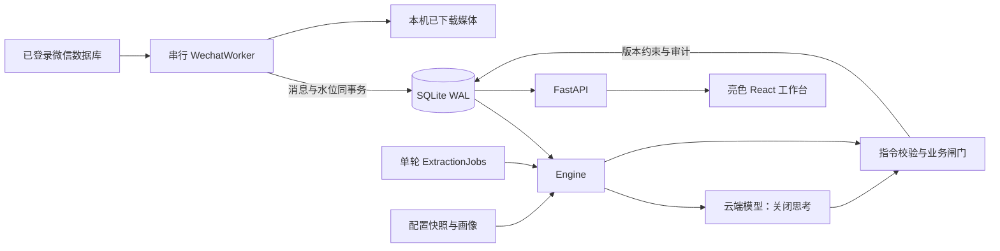

# 架构与数据一致性

## 生命周期与边界

`create_app` 在导入时不连接微信、不打开数据库、不启动线程。FastAPI lifespan 构造 Application，配置、仓储、画像、引擎、采集和作业各自承担明确职责。退出时先停止采集，再请求取消提炼，等待当前有超时的网络请求结束；没有完成提交的消息仍未处理。

2026-10-12 用户授权按稳定缝隙拆大文件：模型提示词文本与系统指令拼装移到 `niannian/prompts.py`，云端未启用时的本地降级（正则候选、关联待办、截止推断）移到 `niannian/local_rules.py`，`parse_time` 从 `engine.py` 下沉到 `storage.py` 供引擎与降级模块共用，使降级不再反向依赖引擎。这是纯搬运：新旧系统指令逐字对拍一致，提炼链路、事务边界、校验顺序与数据流未变。

## 采集：先可靠接住，再决定行动

账号和真实会话构成稳定主键。服务器消息 ID 或原始排序/时间/内容构成源去重键。采集器一个线程读取上游，API 历史导入进入同一个命令队列；不会与监听器并发读取。

`ingest_batch` 的 BEGIN IMMEDIATE 事务包含所有消息与 checkpoint 更新，任何插入失败整体回滚。重启重复扫描水位边界，来源唯一键去重；历史回填不倒退水位。各账号解密缓存、身份映射与媒体隔离，独占锁防止重复采集进程。

本人身份优先取群原文前缀或附件 XML 根发送者。数字索引必须在同账号同会话内被真实原文验证，且与其他发送者不冲突；陈旧上游映射和默认 ID 2 不构成可靠证据。采集保留身份来源与冲突信息，自动完成需要本人且可信。

## 提炼：按会话依次处理，可取消

用户于 2026-10-10 明确要求取消单轮与单会话总量上限。一轮开始时冻结关注会话的未处理消息，静默已满足的会话依次处理，同一会话按单次请求预算连续拆批，全部完成后再处理下一会话。每次请求前复查关注、账号与静默状态；等待期间有新消息导致不再静默时，跳过该会话本轮剩余消息，保持未处理标记。新到消息留待下轮，不追赶不断增长的队列。手动提炼跳过静默等待，但仍复查关注与账号。整轮结束（包括取消或失败）后再等待自动提炼间隔，单一作业通道不变。2026-10-12 用户要求自动轮次不再空跑落档：调度到点先调用 `Engine.has_work()`（与 `pending_messages` 同口径，含关注、账号与静默复查），没有可处理段落就不启动轮次、不写 `runs`，因此 `runs` 里的自动记录都对应真实工作量；手动提炼不受影响，空跑同样留一条可追溯记录。相邻同发送者消息按合并窗口组成一段，来源 ID 全部保留。旧配置文件的 round_limit/per_session_limit/batch_limit/profile_chars 读取时忽略，不主动改写本机文件。

2026-10-10 用户要求取消每次请求段数，单次只按正文预算拆批，无固定段数上限。批量返回条数上限随本次输入数量校验，不再固定20条；仍拒绝重复/越界索引。结构输出与执行彼此独立：即使模型返回 CREATE/RESOLVE，消息语义与角色适用性由模型判断，程序仍检查 is_self、目标会话、同批引用和版本。用户于2026-10-10要求云端失败不再本地兜底：请求失败、某段无效/漏答或同批创建引用未落地时，该段保持未处理，下一轮再请求云端；有效同批结果独立提交。模型未启用时仍可使用本地规则，请求前过滤与业务校验保留；条件邀请和无完整动作进入复核记录。原文不会因上下文裁剪丢失。

### 长正文总结压缩（2026-10-10 用户授权）

用户选择普通总结压缩，不做行动摘要。超过 new_message_chars 的待提炼段落，在同一串行提炼通道中先完整送入已配置模型总结，成功后提炼请求正文使用总结。COMPRESSION_POLICY 要求保留人群/对象/时间/条件/例外/否定/撤销/更正/渠道，指代不明与缺失上下文明确标注，不猜身份、意愿、日期或附件正文。模型返回 complete 只表示其自报当前正文的重要信息已保留，不代表人工验证或完整对话；提示词不能保证语义零遗漏。

总结缓存写入最后一条来源消息 metadata_json.text_compression，不新增表、不迁移 schema。指纹包含原文、所有源ID、账号/会话、目标预算、模型/接口及提示词版本；不匹配则重新总结。保存时校验全部真实来源及正文，合并最新 metadata，保留附件。原文、来源、身份、checkpoint、processed 不被总结覆盖。业务 guard 和模型未启用时的本地处理仍读原文；当前正文与总结不再硬截断；历史参考按完整消息选入预算，放不下整条省略，不后台全量压缩历史。2026-10-10 用户要求取消画像长度限制，画像完整提供；待办预算保持原行为。

完整正文不预先裁剪；上下文过大导致接口拒绝、输出 finish_reason 非 stop、总结为空/超预算/未压缩、complete 非 true 时，不继续发送裁剪正文提炼，也不标记 processed，当前批次留到下一轮。取消与发送前静默复查仍生效，已成功缓存可复用。压缩请求计入原有模型请求数、失败数与耗时；没有另建自动重试通道。压缩输出 token 预算为目标字数三倍（最低1200、最高16000），仍有接口超时和固定 enable_thinking=false；首次长文增加一次请求，缓存复用不再调用总结。

CREATE 精确或保守语义去重；语义合并只接受同动作族、完整规范化独特对象相等且唯一匹配，，并要求当前原文包含该对象。合并追加来源与要求、增加 version、写 MERGE 事件。不能凭泛词或历史背景把新消息挂到旧待办。不同对象、不同动作保留独立任务。

忽略规则需匹配整段，以免某个问候词误伤行动；提炼规则在模型未启用的本地处理时提供行动候选，还必须包含完整动作与对象并通过身份闸门。规则不是无条件创建任务的命令。

每段指令与消息 processed 标记在同一事务内落库。用户编辑的 version 发生变化会阻止旧模型指令覆盖；同批 CREATE 可以明确引用已提交的新任务。取消在批次与段边界检查，未处理部分继续排队。runs 持久化进度，重启标记中断轮次可重试。

每次模型请求另外写入 `model_calls` 诊断表：完整请求体（系统指令 + user JSON）、模型原样回复、解析结果、finish_reason、usage、耗时、错误类型、段落来源ID、上下文预算实际占用，以及结构校验后与业务校验后的指令对照。它是只读旁路：写入失败只记日志，不回滚提炼事务、不改变 processed 与任务结果；请求体不含密钥与接口地址（`enable_thinking=false` 现在直接写在 payload 里，记录即发出内容，不再由 `_post` 偷偷补字段）。诊断行按 `MODEL_CALL_KEEP` 保留最近 1200 次，超限删除最旧的诊断行，不触碰消息、任务、事件与水位。落库结果不重复记录，由 `task_events`、`ignored_messages` 与来源消息ID关联还原。

2026-10-12 用户明确授权删减冗余并完全移除身份确认。采集只保留 `is_self`（正文/XML根账号优先，缺失时回退上游账号），删除数字映射确认及全部确认/冲突派生字段，新消息完整入库；旧数据不清理。模型前的群邀请/公告/角色关键词 gate 和模型后的动作白名单、对象锚点、整段连带否决删除。模型负责语义判断，Engine 只执行一次 `guard_decisions`，检查本人操作边界及配置限制，再沿原事务/版本/来源机制提交。`task_title_max_chars` 默认120（10–120），`max_tasks_per_message` 默认0（0不限，1–100），同轮快照同时传入提示词和最终校验；移除3任务提示词/本地截取与12指令结构上限。模型提案和最终结果在同一诊断行中更新，保留失败留存与引用检查。没有新增复核流程，也没有正式历史重提炼。

## 查询、维护与拓展

消息时间在摄入时规范为 UTC，游标使用会话、时间、ID 组合，防止乱序插入导致漏页。每个连接开启外键与 busy_timeout；SQLite WAL 允许读取与短写入并存。任务手动更新使用乐观版本，事件保留 before/after。备份使用 SQLite backup API 并校验完整性，导出在同一读取快照中完成。

API 层只校验与协调，不维护业务全局。前端使用 Vite、React、TypeScript、Tailwind CSS、shadcn/ui、shadcn/ui Charts（Recharts）与 lucide-react，构建产物随 Python 包分发；网络错误、409 和无效表单保留输入。该前端框架替换由用户于 2026-10-10 明确要求，后端 API 与数据边界不变。媒体路由只返回被真实消息 metadata 引用的已存在附件。

前端源码在 `niannian/web/src/`：`app.tsx` 管理导航、真实概览与单轮进度；`pages/` 按业务模块拆分；`components/ui/` 为本地 shadcn/ui 组件源码，`components/task-drawer.tsx` 负责详情、来源和带 version 的更新，`lib/` 放类型与请求/日期/附件路径工具。样式以 Tailwind 为主，`src/styles.css` 只保留亮色主题与基础规则。图表依赖按构建配置分块，修改后运行 `npm run build`，FastAPI 服务 `web/dist`，不服务 TS 源文件。未构建时首页明确返回 503。

依照同次用户要求移除了命令面板和全部应用自定义键盘快捷操作；保留浏览器标准控件与 shadcn/ui 弹层的基本焦点行为。诊断台数据来自真实 `runs`、`model_calls`、`task_events`、`ignored_messages` 与消息队列，未补造趋势或演示数据；`/api/metrics` 仍提供轮次汇总。开发服务器仅监听 127.0.0.1，API/media 请求代理至原有 8765 服务，不启动第二套采集/提炼通道。

当前 schema 为 v2。SCHEMA 文本只描述 v1 基线，之后的结构变化写在 `storage.MIGRATIONS` 里按版本顺序执行并登记 `schema_version`；v2 只新增 `model_calls` 表与索引，不修改任何 v1 定义。旧库在 `Database.init()` 时自动补上，不需要删库重建；备份与恢复仍按下一节流程。可在独立适配器中增加 OCR/转写，保持原始消息不可变，并让提炼输入明确区分机器识别文本与真实原文；可替换 LLMExtractor 或仓储，避免把服务商耦合带入业务引擎。
