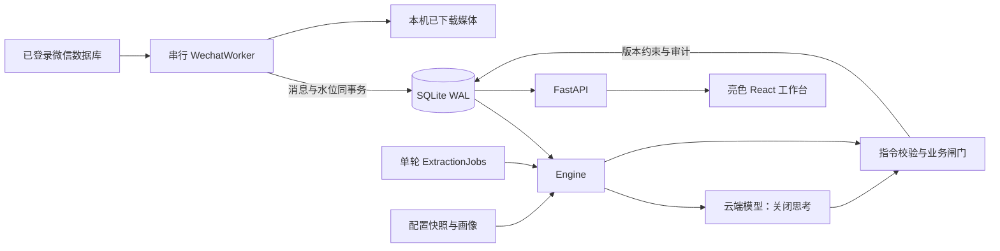

# 架构与数据一致性

## 生命周期与边界

`create_app` 在导入时不连接微信、不打开数据库、不启动线程。FastAPI lifespan 构造 Application，配置、仓储、画像、引擎、采集和作业各自承担明确职责。退出时先停止采集，再请求取消提炼，等待当前有超时的网络请求结束；没有完成提交的消息仍未处理。

## 采集：先可靠接住，再决定行动

账号和真实会话构成稳定主键。服务器消息 ID 或原始排序/时间/内容构成源去重键。采集器一个线程读取上游，API 历史导入进入同一个命令队列；不会与监听器并发读取。

`ingest_batch` 的 BEGIN IMMEDIATE 事务包含所有消息与 checkpoint 更新，任何插入失败整体回滚。重启重复扫描水位边界，来源唯一键去重；历史回填不倒退水位。各账号解密缓存、身份映射与媒体隔离，独占锁防止重复采集进程。

本人身份优先取群原文前缀或附件 XML 根发送者。数字索引必须在同账号同会话内被真实原文验证，且与其他发送者不冲突；陈旧上游映射和默认 ID 2 不构成可靠证据。采集保留身份来源与冲突信息，自动完成需要本人且可信。

## 提炼：有界、有序、可取消

用户于 2026-10-10 明确要求取消单轮与单会话总量上限。一轮开始时冻结关注会话的未处理消息，静默已满足的会话依次处理，同一会话按单次请求预算连续拆批，全部完成后再处理下一会话。每次请求前复查关注、账号与静默状态；等待期间有新消息导致不再静默时，跳过该会话本轮剩余消息，保持未处理标记。新到消息留待下轮，不追赶不断增长的队列。手动提炼跳过静默等待，但仍复查关注与账号。整轮结束（包括取消或失败）后再等待自动提炼间隔，单一作业通道不变。相邻同发送者消息按合并窗口组成一段，来源 ID 全部保留。旧配置文件的 round_limit/per_session_limit 读取时忽略，不主动改写本机文件。

每批最多 4 段并限制文字预算，缩短模型上下文。结构输出与执行彼此独立：即使模型返回 CREATE/RESOLVE，仍检查角色、本人身份、目标会话、同批引用和版本。请求失败或某段返回无效，使用保守规则回退，记录来源为 rule；条件邀请和无完整动作进入复核记录。原文不会因上下文裁剪丢失。

### 长正文总结压缩（2026-10-10 用户授权）

用户选择普通总结压缩，不做行动摘要。超过 new_message_chars 的待提炼段落，在同一串行提炼通道中先完整送入已配置模型总结，成功后提炼请求正文使用总结。COMPRESSION_POLICY 要求保留人群/对象/时间/条件/例外/否定/撤销/更正/渠道，指代不明与缺失上下文明确标注，不猜身份、意愿、日期或附件正文。模型返回 complete 只表示其自报当前正文的重要信息已保留，不代表人工验证或完整对话；提示词不能保证语义零遗漏。

总结缓存写入最后一条来源消息 metadata_json.text_compression，不新增表、不迁移 schema。指纹包含原文、所有源ID、账号/会话、目标预算、模型/接口及提示词版本；不匹配则重新总结。保存时校验全部真实来源及正文，合并最新 metadata，保留附件。原文、来源、身份、checkpoint、processed 不被总结覆盖。业务 guard 和本地回退仍读原文；短消息、旧历史上下文、画像及待办预算保持原行为，不后台全量压缩历史。

完整正文不预先裁剪；上下文过大导致接口拒绝、输出 finish_reason 非 stop、总结为空/超预算/未压缩、complete 非 true 时，不继续发送裁剪正文提炼，也不标记 processed，当前批次留到下一轮。取消与发送前静默复查仍生效，已成功缓存可复用。压缩请求计入原有模型请求数、失败数与耗时；没有另建自动重试通道。压缩输出 token 预算为目标字数三倍（最低1200、最高16000），仍有接口超时和固定 enable_thinking=false；首次长文增加一次请求，缓存复用不再调用总结。

CREATE 精确或保守语义去重；语义合并只接受同动作族、完整规范化独特对象相等且唯一匹配，并要求当前原文包含该对象。合并追加来源与要求、增加 version、写 MERGE 事件。不能凭泛词或历史背景把新消息挂到旧待办。不同对象、不同动作保留独立任务。

忽略规则需匹配整段，以免某个问候词误伤行动；提炼规则在降级时提供行动候选，还必须包含完整动作与对象并通过身份闸门。规则不是无条件创建任务的命令。

每段指令与消息 processed 标记在同一事务内落库。用户编辑的 version 发生变化会阻止旧模型指令覆盖；同批 CREATE 可以明确引用已提交的新任务。取消在批次与段边界检查，未处理部分继续排队。runs 持久化进度，重启标记中断轮次可重试。

## 查询、维护与拓展

消息时间在摄入时规范为 UTC，游标使用会话、时间、ID 组合，防止乱序插入导致漏页。每个连接开启外键与 busy_timeout；SQLite WAL 允许读取与短写入并存。任务手动更新使用乐观版本，事件保留 before/after。备份使用 SQLite backup API 并校验完整性，导出在同一读取快照中完成。

API 层只校验与协调，不维护业务全局。前端使用 Vite、React、TypeScript、Tailwind CSS、shadcn/ui、shadcn/ui Charts（Recharts）与 lucide-react，构建产物随 Python 包分发；网络错误、409 和无效表单保留输入。该前端框架替换由用户于 2026-10-10 明确要求，后端 API 与数据边界不变。媒体路由只返回被真实消息 metadata 引用的已存在附件。

前端源码在 `niannian/web/src/`：`app.tsx` 管理导航、真实概览与单轮进度；`pages/` 按业务模块拆分；`components/ui/` 为本地 shadcn/ui 组件源码，`components/task-drawer.tsx` 负责详情、来源和带 version 的更新，`lib/` 放类型与请求/日期/附件路径工具。样式以 Tailwind 为主，`src/styles.css` 只保留亮色主题与基础规则。页面与图表依赖分块加载，修改后运行 `npm run build`，FastAPI 服务 `web/dist`，不服务 TS 源文件。未构建时首页明确返回 503。

依照同次用户要求移除了命令面板和全部应用自定义键盘快捷操作；保留浏览器标准控件与 shadcn/ui 弹层的基本焦点行为。统计图直接来自 overview，未补造趋势或演示数据。开发服务器仅监听 127.0.0.1，API/media 请求代理至原有 8765 服务，不启动第二套采集/提炼通道。

当前 schema 为 v1。未来新增结构应添加顺序迁移，不能修改已有 v1 定义后宣称历史数据库已升级。可在独立适配器中增加 OCR/转写，保持原始消息不可变，并让提炼输入明确区分机器识别文本与真实原文；可替换 LLMExtractor 或仓储，避免把服务商耦合带入业务引擎。
